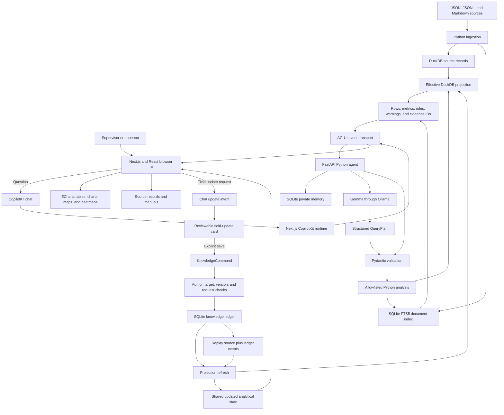

6. **Accept reviewed updates.** A user describes an inspection, correction, or note in chat. The backend prepares a `KnowledgeCommand`, the chat displays it for review, and an explicit save action validates the author, asset, target record, request ID, and expected knowledge version before appending to the SQLite ledger and refreshing the effective projection.
	Browser -->|Field update request| ChatUpdate[Chat update intent]
1. A user describes an inspection, note, or correction directly in the CopilotKit chat.
2. The Python agent recognizes only explicit, supported update formats and prepares a `KnowledgeCommand`; missing values are rejected rather than guessed.
# Digger: approach and technology rationale

## Purpose

Digger is designed to answer operational asset questions with calculations that a supervisor can inspect, repeat, and challenge. The central design decision is to separate language understanding from analytical truth:

- The language model interprets a question and proposes a bounded `QueryPlan`.
- Pydantic validates that plan against the supported operations and inputs.
- Python performs the calculation using the effective data projection.
- The response includes the rows, metrics, rules, versions, warnings, and evidence IDs used to produce it.

This makes the model useful for natural-language interaction without allowing it to invent numerical results, run arbitrary SQL, or silently overwrite source evidence.

## End-to-end approach

1. **Ingest source material.** JSON and JSONL operational records are loaded from the bundled dataset. Markdown manuals and policies are indexed separately for document search. Ingestion is deterministic and records a content hash as the dataset version.
2. **Build the effective view.** Original inspections remain immutable. Corrections and new field observations are applied to an in-memory effective set, which is materialized into DuckDB with derived values such as temperature difference, production status, area, and coordinates.
3. **Understand the question.** The frontend sends a conversational question through CopilotKit and the Next.js runtime to the Python agent. Gemma receives only the compact supported schema, the analysis date, the question, and selected private memory. It returns a structured plan rather than an answer containing unverified numbers.
4. **Validate and calculate.** The backend validates the plan, checks asset and area identifiers, applies the relevant date and scope filters, and runs one allowlisted analytical operation. Calculations are deterministic Python and DuckDB work.
5. **Return inspectable results.** The API returns data for tables and visualizations together with explanations, warnings, evidence IDs, rule thresholds, and data/knowledge versions. Temperature results use compact reading cards for fewer than four observations and a line chart for longer series. The UI can open the underlying source records and manuals.
6. **Accept reviewed updates.** A user describes an inspection, correction, or note in chat. The backend prepares a `KnowledgeCommand`, the chat displays it for review, and an explicit save action validates the author, asset, target record, request ID, and expected knowledge version before appending to the SQLite ledger and refreshing the effective projection.

## Workflow chart

The following chart shows the two main paths through the system. The query path is read-only and evidence-producing. The field-update path changes shared knowledge, but only after validation and version checks.



### Query path in detail

1. The user enters a question or selects a starter analysis in the React interface.
2. CopilotKit carries the conversation through the Next.js runtime. AG-UI streams agent progress and the final analysis result back to the browser.
3. The FastAPI agent supplies Gemma with only the question, supported schema, analysis date, and relevant private memory. It does not send the complete dataset.
4. Gemma proposes one bounded operation. Pydantic rejects missing, invalid, or unsupported fields before execution.
5. The executor applies date, asset, and area filters, reads the effective DuckDB projection, and uses SQLite FTS5 only for document retrieval.
6. The backend returns calculated rows and explicit metadata. ECharts renders those rows; it never calculates a separate answer.
7. The user can open evidence IDs to inspect the original record, correction, field update, or manual excerpt behind the result.

### Field-update path in detail

1. A user describes an inspection, note, or correction directly in the CopilotKit chat.
2. The Python agent recognizes only explicit, supported update formats and prepares a `KnowledgeCommand`; missing values are rejected rather than guessed.
3. AG-UI returns a review card in the same chat. Nothing is saved until the user selects **Review and save update**.
4. The existing knowledge endpoint validates the asset, author, target inspection, expected knowledge version, and idempotency request ID.
5. SQLite appends the accepted command as an event. The original source record is not overwritten.
6. The store replays source records and events to rebuild the effective state and replaces the DuckDB projection.
7. Only after the refresh succeeds does the API report success. A failed refresh blocks analysis rather than serving known-stale results.
| **TypeScript** | Frontend contracts and UI logic | Makes analysis results, views, chat review cards, and API responses explicit at the browser boundary. |
| **Pydantic** | `QueryPlan` and `KnowledgeCommand` validation | Enforces a narrow contract before a question can reach the executor or a chat-proposed write can reach the ledger. |
5. Only after the refresh succeeds does the API report success. A failed refresh blocks analysis rather than serving known-stale results.

## Why each technology is used

| Technology | Role | Reason for choosing it |
|---|---|---|
| **Next.js and React** | Web application and CopilotKit runtime host | Provides the interactive application and keeps the local demo to one frontend process. |
| **TypeScript** | Frontend contracts and UI logic | Makes analysis results, views, forms, and API responses explicit at the browser boundary. |
| **CopilotKit and AG-UI** | Chat transport and streamed agent events | Connects conversational input to interactive analysis cards without making the UI responsible for analytical execution. |
| **FastAPI** | Python API and agent adapter | Gives the analytical backend small, typed HTTP endpoints and automatic API documentation. |
| **Pydantic** | `QueryPlan` and `KnowledgeCommand` validation | Enforces a narrow contract before a question can reach the executor or a write can reach the ledger. |
| **Gemma through Ollama** | Local structured planning | Keeps inference self-hosted for a privacy-sensitive local workflow and avoids sending the full operational dataset to a hosted model. Ollama is optional; starter analyses still work without it. |
| **DuckDB** | Analytical records and effective projection | Handles columnar filtering and aggregation locally with little operational overhead, while remaining easy to rebuild from source records and updates. |
| **SQLite** | Knowledge ledger, private memory, and FTS5 document index | Provides a durable, embedded store for append-only updates, per-user conversation memory, and lightweight full-text search without a separate database service. |
| **ECharts** | Charts, maps, and heatmaps | Turns the same calculated result rows into interactive views while keeping the backend responsible for the numbers. |
| **Python** | Ingestion, validation orchestration, analysis rules, storage coordination, and API integration | Fits the data-processing workload, has mature JSON and database libraries, and keeps the domain rules in one inspectable backend. |
| **pytest** | Backend reference-answer and behavior tests | Makes challenge scenarios executable and repeatable, so corrections to calculations can be checked against expected results. |
| **Node.js** | Frontend runtime and build environment | Runs Next.js and its toolchain consistently on the supported Windows setup. |
| **npm** | Frontend dependency installation and scripts | Uses the lockfile-driven JavaScript package workflow already supported by Next.js. |
| **uv and Python virtual environments** | Python installation and dependency isolation | Makes the Windows setup reproducible without modifying the system Python installation. |
| **HTTPX** | HTTP client and test-client support | Provides asynchronous and synchronous HTTP behavior used by the backend integration surface and its test tooling. |
| **pytz** | Time-zone support | Keeps date and time handling explicit for inspection records and UTC-backed persistence. |
| **Zod** | Frontend runtime schema validation | Validates untrusted API-shaped values at the browser boundary before rendering interactive results. |
| **Lucide React** | Interface icons | Supplies consistent, accessible icons without maintaining custom SVG assets in the UI. |
| **Next.js configuration and TypeScript configuration** | Framework and compiler behavior | Centralizes frontend build, module, and type-checking rules so development and production builds use the same contracts. |

### Technology responsibilities by layer

#### Browser and interaction layer

**React** owns the component model and interactive state. **Next.js** supplies routing, the development server, the production build, and the server-side runtime that hosts the CopilotKit endpoint. **TypeScript** describes API responses, analysis views, form data, and event payloads so a backend shape change is visible during type-checking. **Zod** adds runtime protection because TypeScript types disappear when JavaScript runs. **Lucide React** provides the icons used for actions and navigation. **ECharts** renders charts, heatmaps, and geographic views from already-calculated result rows.

#### Conversation and transport layer

**CopilotKit** provides the chat and interactive assistant integration in the frontend. Its **Next.js runtime** receives the conversation and connects it to the Python agent. **AG-UI** provides the event-oriented stream between the runtime and the agent, allowing progress, assistant text, and analysis results to arrive as a coherent interaction rather than as unrelated polling requests.

#### API and domain layer

**FastAPI** exposes the HTTP endpoints for analysis, chat, field updates, evidence, and memory. It also generates an OpenAPI document at `/docs`, which makes the local API inspectable. **Pydantic** defines the input contracts, including `QueryPlan` for reads and `KnowledgeCommand` for writes. **Python** coordinates these contracts, applies domain rules, performs deterministic calculations, and controls the lock shared by reads and writes.

#### Storage and search layer

**DuckDB** stores source records and the derived `effective` projection because analytical queries benefit from columnar execution and SQL aggregation. It is deliberately treated as rebuildable. **SQLite** stores the append-only knowledge ledger and user memory, and its **FTS5** extension indexes Markdown documents for fast keyword retrieval. The two databases have different responsibilities: SQLite is authoritative for changes, while DuckDB is optimized for analytical reads.

#### Model and local operations layer

**Gemma** is used for language interpretation and structured plan selection, not for arithmetic or unrestricted tool execution. **Ollama** provides a local model-serving endpoint, so operational data can remain on the laptop. **uv**, a Python virtual environment, **Node.js**, and **npm** make the local installation reproducible. Ollama is optional for deterministic starter cards, which keeps the core demo available when a model is not installed.

#### Verification layer

**pytest** checks backend behavior and reference answers. TypeScript's compiler checks the frontend contract with `npm.cmd run typecheck`. **Next.js** production compilation checks that the browser application can be packaged with `npm.cmd run build`. Together these checks cover domain behavior, frontend types, and deployability, while evidence review and authorization review remain human responsibilities.

## Data integrity and trust boundaries

The system uses two complementary data stores rather than treating the analytical database as the source of truth:

- **Source files are immutable.** They provide the original operational evidence.
- **SQLite events are authoritative for user changes.** Each event has an author, request ID, timestamp, payload, and version. Duplicate request IDs are rejected unless they repeat the same command.
- **DuckDB is rebuildable.** It contains the effective analytical projection, so a projection can be recreated by replaying source data and the event ledger.
- **The model is outside the calculation boundary.** It can select a supported operation, but it cannot execute SQL, choose arbitrary code, or fabricate chart data.
- **Private memory is scoped by demo user.** Shared corrections affect everyone; conversation history is supplied only for the selected user. The user picker is not authentication.

When a projection refresh fails after a write, the event remains persisted but analyses are blocked until the projection is rebuilt. This avoids returning a successful update while serving stale analytical results.

## Deliberate trade-offs

- **Local-first over hosted scale:** local inference and embedded databases simplify setup, privacy, and reproducibility, but this version is intended for a trusted local demo rather than a multi-tenant production deployment.
- **Bounded plans over open-ended agents:** limiting the first slice to supported operations makes results auditable and testable, but multi-stage questions and general reasoning are not yet supported.
- **Evidence over polished certainty:** warnings expose synthetic data, truncation, corrections, disagreements, and unknown values instead of hiding them in a confident summary.
- **Rebuildable projection over complex transactions:** SQLite owns writes and DuckDB serves reads, which keeps responsibilities clear but requires a refresh step and a failure state.
- **Explainable maintenance prioritization:** corrective recurrence, current operating state, consecutive stops, and recent spills produce a transparent priority score with evidence and recommended action. It is intentionally not presented as a calibrated failure probability.

## Current scope and next steps

Implemented capabilities include status, temperature, spill, downtime, cost, maintenance recurrence, predictive-maintenance priority, compliance, late containment, reportability, RCA, planned downtime, and disputed-spill analysis. Results retain source-linked evidence and use interactive views. Reviewed natural-language updates cover corrections, dated field notes, conflicting claims, and well-type policy overrides; corrections are shared while conversation memory remains private to each user.

The next architectural increments are source-grounded model synthesis, multi-stage analytical plans, a workflow for resolving and closing recorded conflicts, generalized ingestion for additional datasets, real authentication and tenant isolation, and temporal evaluation of the maintenance-priority signals before any calibrated forecast is claimed.

## Verification

The intended checks are:

```powershell
.\.venv\Scripts\python.exe -m pytest -q
cd frontend
npm.cmd run typecheck
npm.cmd run build
```

These checks cover the backend reference answers and the frontend's type and production-build contracts. They do not replace review of source evidence or authorization design before production use.
