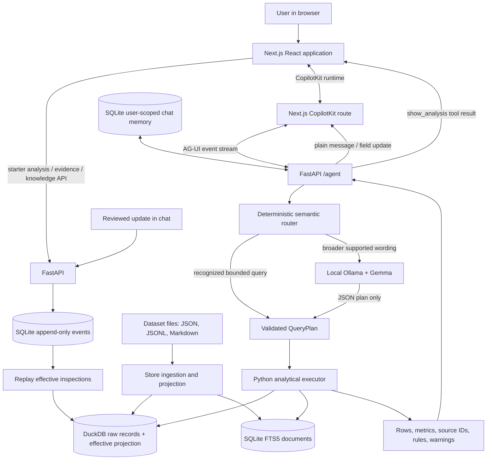
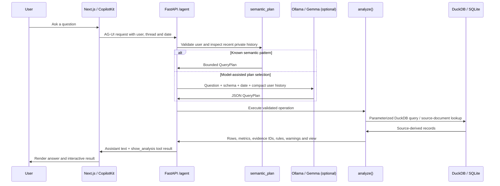

# Digger system architecture

This document describes the implementation in this repository as it exists today. It covers the browser application, the CopilotKit and AG-UI chat path, bounded analytical operations, source-data ingestion, the shared knowledge ledger, evidence delivery, and the limits that matter when interpreting results.

Digger is a local-first operational intelligence prototype for the synthetic FlytBase asset dataset. Its core design choice is to keep record calculations in Python and DuckDB. The local language model can propose a query plan for open-ended questions, but it does not execute SQL, modify source files, or supply calculated totals.

## Contents

1. [System goals and design boundaries](#1-system-goals-and-design-boundaries)
2. [Component map](#2-component-map)
3. [Runtime and process topology](#3-runtime-and-process-topology)
4. [Dataset layout and ingestion](#4-dataset-layout-and-ingestion)
5. [Persistence model](#5-persistence-model)
6. [Effective values, corrections and derived status](#6-effective-values-corrections-and-derived-status)
7. [Query and chat lifecycle](#7-query-and-chat-lifecycle)
8. [Query contract and analytical executor](#8-query-contract-and-analytical-executor)
9. [Evidence and rule provenance](#9-evidence-and-rule-provenance)
10. [Visual rendering and result contract](#10-visual-rendering-and-result-contract)
11. [Shared knowledge updates](#11-shared-knowledge-updates)
12. [HTTP and streaming interfaces](#12-http-and-streaming-interfaces)
13. [Replacement-dataset validation and restart](#13-replacement-dataset-validation-and-restart)
14. [Error handling, concurrency and consistency](#14-error-handling-concurrency-and-consistency)
15. [Security and privacy properties](#15-security-and-privacy-properties)
16. [Implemented scope and known gaps](#16-implemented-scope-and-known-gaps)
17. [Extension pattern for new analytical features](#17-extension-pattern-for-new-analytical-features)
18. [Verification commands](#18-verification-commands)

## 1. System goals and design boundaries

Digger is designed to:

- Load a directory of well records and fleet documents without rewriting those records.
- Calculate bounded, repeatable answers from inspections, maintenance, context notes, regulatory events, and operating documents.
- Explain which records and rules support an answer.
- Accept reviewed shared corrections and field notes while retaining the source record and the author of each change.
- Keep shared field facts separate from each demo user's private conversation memory.
- Run locally with a self-hosted Next.js frontend, a FastAPI backend, SQLite, DuckDB, and optional Ollama inference.

It is a trusted local demo, not a multi-tenant production service. The user picker identifies a demo user but is not authentication. No authorization boundary protects one user's private state from a person who can access the local service directly. The dataset and its operating rules are fictional.

## 2. Component map



The main code boundaries are:

| Component | Main files | Responsibility |
|---|---|---|
| HTTP and application lifecycle | [`backend/app.py`](../backend/app.py) | Creates the FastAPI application, opens and closes the store, exposes JSON and AG-UI routes. |
| Contracts | [`backend/models.py`](../backend/models.py) | Pydantic schemas for query plans, chat requests, inspections and knowledge commands. |
| Ingestion and persistence | [`backend/store.py`](../backend/store.py) | Reads the dataset, builds DuckDB projections and document search, stores/replays shared events and private memory. |
| Semantic routing and chat | [`backend/agent.py`](../backend/agent.py) | Recognizes known question patterns, optionally asks Gemma for a plan, builds reviewed updates, and formats concise chat answers. |
| Deterministic calculations | [`backend/analysis.py`](../backend/analysis.py) | Executes allowlisted operations and constructs evidence-bearing result objects. |
| Dataset preflight | [`backend/validate_dataset.py`](../backend/validate_dataset.py) | Runs the real ingestion pipeline against a candidate dataset and optionally replays an existing ledger in a temporary directory. |
| User interface | [`frontend/app/page.tsx`](../frontend/app/page.tsx), [`frontend/components/AnalysisView.tsx`](../frontend/components/AnalysisView.tsx) | Starter analyses, chat, result rendering, evidence panel and reviewed update form. |
| CopilotKit server runtime | `frontend/app/api/copilotkit/[[...slug]]/route.ts` | Hosts the CopilotKit runtime in Next.js and connects the browser chat to the Python AG-UI agent. |

## 3. Runtime and process topology

The local development setup runs two long-lived processes:

1. FastAPI runs from the repository root on `http://127.0.0.1:8000`. During startup it opens the dataset and state stores.
2. Next.js runs from `frontend/` on `http://127.0.0.1:3000`. It serves the React UI and the CopilotKit runtime. The browser calls backend endpoints through the `/backend` proxy configured by the frontend, and chat uses the Next.js CopilotKit route before reaching FastAPI's `/agent` endpoint.

Ollama is a third, optional process. It is contacted only when deterministic routing cannot produce a plan and the chat request needs model-assisted plan selection. Starter-card analyses and recognized routes such as the gas-response and bypass questions are computed without Gemma. If model inference is needed but Ollama is unavailable, the API reports that explicitly.

The backend defaults to `flytbase-ahc-swe-asset-intelligence-dataset-main/test-data/dataset`, whose `assets/` and `fleet/` directories are at that level. `DIGGER_DATASET` can select another compatible root. `DIGGER_STATE` selects the directory holding the SQLite and DuckDB files. The default analysis date is 15 Jan 2027, matching the test dataset release; the UI date selector and chat request can provide a different date.

## 4. Dataset layout and ingestion

The loader expects a dataset root with this general shape:

```text
dataset/
  assets/
    WELL-0001/
      metadata.json
      inspections.jsonl
      maintenance.jsonl
      regulatory-events.jsonl
      context.jsonl
      *.md                  # linked repair reports and other well documents
  fleet/
    areas.json
    users.json
    well-types/*.md
    sops/*.md
```

The validator additionally checks for the required per-well files and verifies that referenced wells, users, areas, inspections and report files exist. Optional fields are retained in each source JSON object even when no analytical operation currently consumes them.

At startup, `Store.ingest()` walks the source tree in stable path order. It reads JSON and JSONL files into DuckDB's `records` table as JSON payloads, keeping each source record's ID, kind, relative path and line number. Source IDs are checked for duplicates before the batch replace. Markdown files are indexed into SQLite FTS5, including fleet manuals/SOPs and Markdown repair reports. Fleet users and area definitions are loaded into Python lookup structures. Well-type manuals are scanned for the production temperature threshold used by status calculations.

The loader calculates a short SHA-256 fingerprint over relative paths and file contents. The API returns this dataset version with each analytical result, allowing a reviewer to tell which source snapshot was used. It is a content fingerprint, not a schema migration number.

The currently configured test release has 600 wells, 125,198 inspections, 17,415 maintenance records, 328 regulatory events, 1,887 context notes, 4,449 Markdown documents, seven areas and T200/T350/T500 manuals. It adds type and team history, operator notes, data-correction notes, MOC documents and additional repair-report sections. The pipeline preserves those records. Support for a new record shape does not by itself mean that a question using that shape has a completed analysis operation; feature coverage is listed below.

## 5. Persistence model

The configured state directory contains two database files:

### `analytics.duckdb`

- `records`: ingested source JSON values in a JSON column, indexed in application queries by `kind` and record ID.
- `effective`: a rebuildable, flattened inspection projection used by SQL operations. It contains the effective values needed for time, temperature, production status, area/team grouping and spill analysis, together with coordinates and evidence identifiers.

The projection is rebuilt from source records plus accepted ledger updates. DuckDB is not the authoritative store for user changes.

### `knowledge.sqlite`

- `events`: append-only shared updates. The monotonically increasing `version` is the knowledge version; `request_id` is unique for idempotent writes.
- `memory`: question, answer, selected asset IDs, user ID and thread ID for conversation recall. The chat planner reads recent memory scoped to the selected user.
- `documents`: FTS5 index of Markdown source documents. It is recreated from the currently configured dataset at ingestion.

The original JSON, JSONL and Markdown inputs are not mutated. A correction changes the effective projection while the original value remains inspectable. The shared ledger and private memory live in the state directory, so changing the dataset path does not automatically clear saved knowledge or conversations.

## 6. Effective values, corrections and derived status

The inspection projection is assembled in a defined order:

1. Read source inspections into an inspection-ID map.
2. Apply supported source `data_correction` context notes to the named inspection field, retaining correction-note IDs in the change map. The supported source fields are wellhead temperature, ambient temperature, spill volume and spill detection.
3. Apply the currently recognized narrative spill-correction pattern for older source data.
4. Replay accepted shared events in version order. New-inspection events add rows; correction events replace only the target field in the effective view.
5. Derive per-reading values: temperature delta, historical well type, type threshold, producing flag, area/team, coordinates and decommissioned status.

Production is a rule-based classification, not a measured oil rate. For each inspection, the loader picks the well type whose `type_history` period covers the inspection date, applies that manual's temperature threshold to `wellhead_temp_c - ambient_temp_c`, and marks readings on or after a decommission date as not producing. Missing inspections are not filled or interpolated. This supports questions such as “is the well producing oil?” according to the supplied synthetic rule; it cannot answer production volume or rank barrels produced.

Team assignment for an inspection uses the well's `team_history` on that inspection date, then the well-level `team_id`, then the area's team. Area is taken from the well metadata. Status and cost analyses use dates and the selected as-of date rather than file order; late-entered inspection and maintenance records are therefore not assumed to be chronologically positioned in their files.

## 7. Query and chat lifecycle



`semantic_plan()` handles known patterns before contacting Ollama. It extracts explicit well IDs, known area names/IDs, date windows, requested visual and result limit. For broader language, Gemma is given a compact Pydantic-generated JSON schema, analysis date, known area choices, recent history for that user and a list of operations. Its response must parse as a `QueryPlan`; invalid output is rejected. The model does not receive all 125,000+ inspections and does not construct executable SQL.

After planning, the chat handler enforces an explicit visual requested by the user, adjusts limits for chart/map views, calls `analyze()`, and creates a deterministic assistant answer from the result explanation and metrics. It saves the answer and selected asset IDs in private memory for later references. The result tool carries the full bounded analysis object for frontend rendering.

Some data limitations short-circuit to a plain assistant message rather than an analysis card. For this dataset, pressure questions explain that there are no numeric pressure readings, and oil-production ranking questions explain that temperature status and spill barrels do not provide per-well production volumes. These guards avoid presenting an empty document-search response as a verified quantitative analysis.

## 8. Query contract and analytical executor

`QueryPlan` is a strict Pydantic model. It allows only named operations and constrained fields: asset IDs, area, inclusive start/end dates, non-producing filter, equipment kind, team ID, result limit, view and document search text. Unknown properties are rejected. `start` cannot be after `end`. `KnowledgeCommand` is a separate strict write contract and cannot be confused with a query plan.

`analyze(store, plan)` is the deterministic execution boundary. It holds the store's re-entrant lock, validates requested asset and area scope, binds SQL values as parameters, calculates full-result metrics, then returns only the requested number of rows. `total_rows` remains the full matching count; when rows are truncated a warning states that fact. Charts use the displayed row set, so the result carries both displayed and full totals.

Implemented operation families include:

| Operation | Source joins and calculation | Typical output |
|---|---|---|
| `status` | Latest effective inspection per well by inspection time; type-specific threshold; status/context/repair explanation and correction conflicts. | Status card for a small set, otherwise a table. |
| `status_disagreements` | Latest inspection compared with the latest explicit operator note about producing or stopped state. | Evidence table with inspection and note IDs. |
| `temperatures` | Effective wellhead and ambient readings over a selected period; no interpolation. | Line chart, or compact temperature cards for one to three auto-view rows. |
| `regional_temperatures` / `hottest_wells` | Mean observed wellhead-minus-ambient delta and spread/count statistics by area or well. | Bar chart. |
| `downtime` | Seven days for each observed non-producing inspection; missed inspections add no days. | Summary for one result, bar chart for multiple. |
| `spills` | Effective spill flags and corrected known volumes; unknown volumes remain explicitly counted. | Table, map, or heatmap based on request. |
| `costs`, `maintenance`, `repair_reasons` | Maintenance rows filtered by job start date; costs summed once per job; recurrence and recorded issue/action grouped as appropriate. | Table or bar chart. |
| `compliance`, `containment`, `reportable_spills` | Effective spill observations joined to regulatory events, maintenance reports and SOP time limits. | Table with breach/pending/met status and linked evidence. |
| `rca` | Corrective repairs by equipment and well over the rolling year, compared with manual threshold or saved scoped override. | Table. |
| `planned_downtime`, `spill_review` | Dated human notes and competing source notes joined to inspection/repair evidence. | Table or card. |
| `gas_response` | Operator gas-odor notes since the selected date joined to the first later maintenance start or manual inspection; drone inspections do not qualify. OPS-1 uses a 24-hour deadline before 1 Jan 2027 and 12 hours from that date. | Table with report time, response ID/time, elapsed hours, deadline and outcome. |
| `bypasses` | Operator-note bypass in/out events matched to MOC well lists, effective dates, expiries and extensions. Shows current bypasses plus historical expired or unapproved episodes. | Table with dates, MOC and status. |
| `search` / fallback | SQLite FTS5 excerpts from Markdown manuals, SOPs, regulator documents and repair reports. Search evidence is retrieval, not a compliance finding. | Excerpt table. |

The executor attaches record IDs to results and rule-document paths to the `rules` field. It also returns warnings, the dataset fingerprint, knowledge version, analysis date and selected visual. The frontend uses those fields for provenance and rendering.

## 9. Evidence and rule provenance

Evidence is deliberately divided into two shapes:

- Record evidence is identified by source record IDs, such as `INS-...`, `MNT-...`, `CTX-...` and regulatory event IDs. The frontend opens records with `/api/evidence/{record_id}`.
- Document evidence is identified by a relative Markdown path, such as a well-type manual, SOP, MOC or repair report. The frontend opens it with `/api/document?path=...`.

`/api/document` resolves the path against the configured dataset root and rejects paths that escape that root, non-Markdown paths and missing files. The source IDs and rules are not generated by Gemma. They are emitted by the operation that used the records or documents.

Corrections are visible in the effective result while the evidence panel can still show the original source payload and the correction IDs. The UI also displays warnings when a corrected value conflicts with the original inspection note or a recorded status.

## 10. Visual rendering and result contract

The result object has these important fields:

| Field | Meaning |
|---|---|
| `operation` and `plan` | Which bounded calculation ran and the validated parameters. |
| `rows` and `total_rows` | Displayed rows and full number of matching rows. |
| `metrics` | Backend-computed summary values over the full result. |
| `explanation` | Deterministic statement of the calculation and its interpretation. |
| `evidence_ids` | Clickable source-record identifiers. |
| `rules` | Dataset-relative Markdown documents that define applicable rules. |
| `warnings` | Limits, corrections, synthetic-data note and truncation disclosure. |
| `dataset_version`, `version`, `as_of` | Source fingerprint, knowledge-ledger version and analysis date. |
| `view` | Requested or selected UI visualization. |

`AnalysisView` selects a preferred table schema per operation to avoid displaying internal fields such as evidence arrays or full context objects. It renders ECharts for lines, bars, heatmaps and coordinate scatter maps; maps use local longitude/latitude and make no external tile requests. Status results use cards where appropriate. User-specified visuals take precedence over automatic selection. Small auto-view temperature sets use temperature cards rather than a sparse line chart.

The evidence drawer opens source records and rule documents without replacing the analysis. Table filtering is performed over the displayed result set in the browser. A chart or map is likewise limited to the displayed rows; backend totals and truncation warnings prevent that subset from being mistaken for the entire data population.

## 11. Shared knowledge updates

An update follows a prepare-review-save lifecycle:

1. The chat parser recognizes a supported correction, new inspection, dated note or scoped RCA policy and creates a `KnowledgeCommand` proposal. It does not write immediately.
2. The answer explains what was resolved and, for temperature or spill corrections, previews the effect on derived status or reporting duties.
3. The CopilotKit `field_update` renderer shows the proposed values. For a correction it fetches the target source record so the reviewer can compare original and proposed fields.
4. On save, the browser posts the command to `/api/knowledge`.
5. The store validates user, asset, target ownership, required payload and `expected_version`. A repeated `request_id` with the same payload is idempotent; reusing it for a different payload is rejected. A stale knowledge version is rejected so the user must refresh and review again.
6. The accepted payload is appended to SQLite and the effective projection is rebuilt. The original file stays untouched.

If projection refresh fails after an event has been saved, the store marks the projection as failed and refuses further analyses until restart/rebuild. This favors an explicit stale-state error over returning answers from an old projection while claiming the write succeeded.

Shared corrections/notes/policies are visible across selected demo users. Conversation memory is keyed by `user_id` and is not shared as an answer history with other users. The current memory model stores selected asset IDs to resolve follow-up questions; it is not a general preference, recall, or full conversational knowledge graph.

## 12. HTTP and streaming interfaces

| Route | Method | Purpose |
|---|---|---|
| `/api/health` | GET | Health, well/inspection counts, knowledge version, dataset version and model name. |
| `/api/users` | GET | Demo user list. |
| `/api/assets` | GET | Loaded asset metadata. |
| `/api/analyze` | POST | Execute a validated `QueryPlan` directly. |
| `/api/chat` | POST | Route a user message and return an analysis object, field-update proposal or plain assistant message. |
| `/agent` | POST, Server-Sent Events | AG-UI stream consumed by CopilotKit. Emits run lifecycle, assistant text, and optionally `show_analysis` or `field_update` tool results. |
| `/api/evidence/{record_id}` | GET | Retrieve an original source record or accepted update record. |
| `/api/document?path=...` | GET | Retrieve a Markdown source document under the configured dataset root. |
| `/api/knowledge` | GET | Read recent shared ledger events. |
| `/api/knowledge` | POST | Append a reviewed shared update. |
| `/api/history/{user_id}` | GET | Read that demo user's recent saved conversations; optional `thread_id` narrows the result. |

Pydantic validation errors and user/target errors are returned as client errors; a knowledge-version conflict returns HTTP 409. Model unavailability on `/api/chat` is HTTP 503. The AG-UI adapter sends a normal assistant text event for plain `kind: message` responses and finishes without rendering an analysis tool. Unhandled analysis errors are sent as a run error rather than fabricated results.

## 13. Replacement-dataset validation and restart

`backend.validate_dataset` creates a temporary state directory, optionally copies in only the current `knowledge.sqlite` ledger, then constructs the real `Store`. It therefore exercises the same parsing, rules extraction, DuckDB batch ingestion, effective projection and document indexing used by the application. It checks required files, well-area/type references, inspection and repair links, regulatory and context references, report-file paths, users and replay compatibility of saved updates. It prints a content fingerprint and record counts on success.

Recommended replacement procedure:

1. Stop the backend so database files are not open.
2. Run `python -m backend.validate_dataset <dataset-root> --state <state-dir>`.
3. Set `DIGGER_DATASET` if the new root is not the repository default.
4. Restart FastAPI. The frontend does not need a rebuild when only data changes.
5. Check `/api/health` for the new well count and dataset fingerprint.

The validation command does not replace files or mutate the active database. When doing a clean evaluation, point `DIGGER_STATE` at a new directory; otherwise the shared ledger and private conversation memory remain. The old sample dataset is kept separately for regression tests.

## 14. Error handling, concurrency and consistency

The store uses a re-entrant lock around ingestion, shared writes, projection rebuilds and analysis. The app uses an async model lock around chat/model execution to avoid simultaneous use of its single in-process planning path. DuckDB's analytical values are bound as parameters, while operation choice comes from the literal allowlist.

Useful runtime failure cases include:

- Dataset root missing `assets/`: application startup fails with the configured path.
- Duplicate source IDs or ambiguous well-type manual threshold: ingestion fails rather than silently choosing one.
- Unknown asset/area or invalid date range: request is rejected.
- Ollama unavailable: only requests requiring model-assisted planning are affected; deterministic starter operations continue to work.
- Stale shared knowledge version: update is rejected with a conflict and should be reviewed again.
- Failed effective projection after a write: analysis is blocked until the store is restarted and replayed.
- Empty document search: excerpts may be absent, but search is not evidence that a measurement or operational event did not occur. A domain question should have a dedicated operation or a clear limitation response.

## 15. Security and privacy properties

- The service binds to localhost in the documented setup.
- CORS is restricted to the local frontend origins.
- Markdown document lookup is constrained to the configured source root.
- The model receives a schema and recent history for the selected demo user, not all raw records.
- SQL is written in backend code and uses bound values; model output is validated as data.
- Shared write commands carry author ID, request ID and expected knowledge version.

These are useful local-demo safeguards, not a production security posture. There is no login, token validation, tenant isolation, deployment hardening, audit export, retention control or role-based authorization. Anyone who can access the server can call its local APIs, including selecting a demo user's ID.

## 16. Implemented scope and known gaps

The system supports a substantial subset of the 600-well release, but the operation name appearing in `QueryPlan` or in deterministic routing does not guarantee that the executor implements it. `analysis.py` currently has dedicated deterministic branches for the operations described in Section 8. Operations such as `recall`, `team_info` and `cold_weather` are present in the query schema/router but do not yet have dedicated executor branches; they fall through to document search and must not be represented as completed analyses.

Other explicit limits:

- **Pressure:** the test records contain no numeric reservoir-pressure telemetry. The chat path returns a plain explanation and requests values, units and dates. It cannot make a pressure map from well coordinates.
- **Oil volume production:** no per-well production volumes/rates are available. “Producing” is a temperature-threshold status; spill barrels are unrelated to oil output. The chat path explains that a highest-producer ranking cannot be computed.
- **Status disagreements:** the current operation compares explicit operator-note language with the latest effective inspection and surfaces conflicts. It is not yet a complete interpreter for every OPS-3 precedence case or every note phrasing.
- **Recall and conversational multi-topic work:** persistent memory currently stores recent Q&A and asset selections. It does not track a durable inventory of installed parts/recalls or compose an arbitrary sequence of several topics into one analytical plan.
- **Operator-note predictive ranking:** the predictive-priority score uses maintenance recurrence, production observations, consecutive stops and recent spills. It does not yet incorporate the new operator-note evidence and follow-up scheduling described by the final questions.
- **Waiting-time analysis:** repair start/completion fields exist, but there is no dedicated by-area analysis that classifies parts, crew, contractor or weather delays.
- **Forecast quality:** predictive-maintenance scores are explainable triage priorities, not failure probabilities, remaining useful life or validated forecasts.
- **General planning:** the agent executes one bounded analytical plan per question. Multi-stage joins and model-written source synthesis are not general capabilities.

When an evaluation question asks for a field or relationship that has no deterministic operation, the correct product behavior is a clear limitation message or an explicit unsupported response, not an empty “verified analysis” card derived from document search.

## 17. Extension pattern for new analytical features

New domain questions should be implemented end to end rather than added only as a model operation:

1. Identify exact source records, timestamps, corrections, manuals and SOP clauses that define the answer.
2. Define date, inclusion, tie-breaking, missing-value and historical-status semantics.
3. Add a bounded operation and fields to `QueryPlan` only if the source supports a computation.
4. Add deterministic routing for the expected language, plus a model-planning description if broader phrasing is useful.
5. Implement the calculation in `analysis.py`, including all matching rows, metrics, evidence IDs, rule paths and warnings.
6. Add operation-specific preferred table columns or chart encoding in `AnalysisView`.
7. Add tests using the release dataset that assert exact counts, IDs, boundaries and absent-data behavior.
8. If a requested quantity is not present in the dataset, return a plain response describing the missing inputs rather than inventing a proxy.

## 18. Verification commands

From the repository root:

```powershell
.\.venv\Scripts\python.exe -m pytest -q
```

From `frontend/`:

```powershell
npm.cmd run typecheck
npm.cmd run build
```

To validate the configured release dataset with the current shared update ledger:

```powershell
.\.venv\Scripts\python.exe -m backend.validate_dataset .\flytbase-ahc-swe-asset-intelligence-dataset-main\test-data\dataset --state .\data
```
