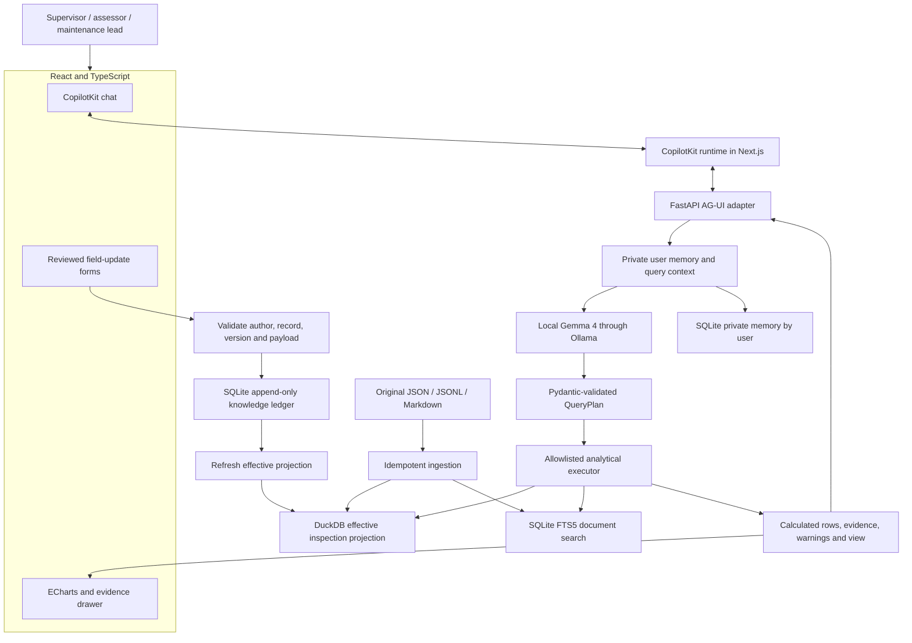

# Digger — architecture and unique features

Digger combines operational records, documents, and field updates to answer questions with reproducible calculations. Its name remains Digger.

## Architecture

Next.js hosts React and the CopilotKit runtime in one process, reducing local setup. Python remains responsible for analysis and storage.

## What reaches Gemma

The question, compact supported schema, analysis date, and the selected user's recent memory. Gemma proposes a validated plan. It does not receive all inspections, execute generated SQL, or invent chart data. This first slice uses deterministic explanations after calculation; model-written cited synthesis is a next step.

## Unique features

1. **Correction propagation.** Correct WELL-0164's temperature, preserve the original, and watch the non-producing list change from four wells to three. Version checks prevent stale submissions; request IDs prevent duplicates.
2. **Reproducible calculations.** Answers include plan, data/knowledge versions, record IDs, rules, and warnings. Downtime comes from weekly inspections, not repair duration.
3. **Field input.** Add new inspections, shared notes, or historical corrections through reviewed forms. New observations do not erase history. Natural-language form prefill is a follow-on feature.
4. **Shared facts, private memory.** Corrections are shared, while conversation history is selected by user. Demo identity separation is not production authorization.
5. **Visible disagreements.** Original notes survive corrections; stale recorded status is flagged. General semantic contradiction resolution remains follow-on work.
6. **Bounded local intelligence.** Gemma plans; validated tools calculate. No arbitrary frontend code or SQL execution.
7. **Interactive evidence.** Switch views, filter tables, open records and manuals. Truncated results are disclosed. Geographic views use coordinates without external tiles.

## Contracts and APIs

| Contract | Responsibility |
|---|---|
| QueryPlan | Operation, assets, area, dates, limit and visual |
| KnowledgeCommand | Update kind, target, author, request ID and expected version |
| Analysis result | Computed rows, totals, source IDs, rules, warnings and versions |
| AG-UI stream | Run events, assistant text and show_analysis tool result |

FastAPI publishes API documentation at `/docs`. Analytics use `/api/analyze`; chat uses `/api/chat` or `/agent`; field writes use `/api/knowledge`.

## Data consistency

Original files stay immutable. SQLite owns updates; DuckDB is a rebuildable projection. Analyses and writes share a lock. Projection refresh completes before a successful write response; failures block subsequent analyses until rebuild. Restart replays the ledger. Private memory is stored separately from shared events.

## Maintenance honesty

Current maintenance analytics expose corrective recurrence and repair costs. They are not calibrated failure probabilities. Historical anomaly baselines, scoped RCA rules and temporally evaluated forecasting remain future work.

## Three-minute demo

Show stopped wells in Northeast Block 8; open WELL-0164's evidence; review a correction to 41°C; rerun to see four become three; switch users; show the corrected shared state and retained original; open private conversation history.
